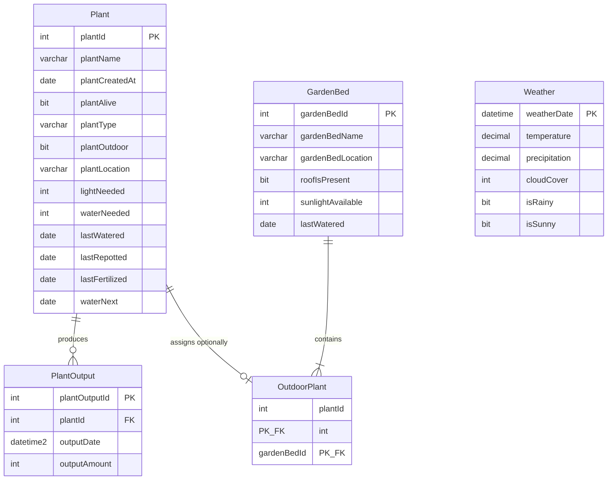

# PlantTracker

A plant and garden management system designed to track watering schedules, fertilizing cycles, harvests, and integrate weather insights. 

This project was originally developed as a **University Project for the Database 2 module**. It initially relied on a campus-internal Microsoft SQL Server requiring a VPN connection. To make this project open-source and standalone the architecture was adjusted by **migrating all core database assets to PostgreSQL running inside a Docker container**.

---

## Important Notice: Development Environment Only

**This repository is configured strictly for a local development environment and is NOT production-ready.**

Before considering any production deployment, the following security and architectural changes are mandatory:
* **Secret Management:** All credentials, database passwords, and API keys are currently handled via plain-text environment variables in the `.env` file and Docker configurations. For production, these must be migrated to a secure secrets manager (e.g., Spring Cloud Vault, AWS Secrets Manager, or encrypted Docker Secrets).
* **Database & Volumes:** The Dockerized PostgreSQL setup is optimized for local testing and rapid prototyping. It lacks the enterprise backup strategies, persistent volume configurations, and fine-tuned connection pooling required for a stable production environment.
* **CORS & Security:** Cross-Origin Resource Sharing (CORS) and security filters are configured loosely to allow seamless communication between the local Angular dev server and the Spring Boot backend.

---

## Tech Stack

### Core Technologies

* **Backend:** Java 21, Spring Boot (Spring Web, Spring JDBC), Maven, Lombok
* **Frontend:** Angular 20, TypeScript, HTML, CSS (Node.js v24, npm v11)
* **Database:** PostgreSQL (Originally Microsoft SQL Server)
* **Infrastructure:** Docker, Docker Compose
* **Development Environment:** Linux Mint (VM Hosted on Windows via VMware), VS Code, Git

### Architectural Design

* **Frontend:** Built with standalone UI **Components** and HTTP **Services** for REST API communication
* **Backend:** Layered architecture consisting of **REST Controllers** (API endpoints), **Services** (business logic handling), **Repositories** (JDBC database access), **Mappers** (DB rows to Java objects), and automated **Schedulers** for third-party Weather-API integration
* **Database:** Relational Database Model, aditionally **Triggers** for automated event flows, **Stored Functions** for algorithmic computations and **Views** for aggregated data access

---

## Features

* **Plant & Garden Bed Management:** CRUD operations (Create, Read, Update, Delete) to organize individual plants and garden beds
* **Harvest Tracking:** Log and review yield statistics 
* **Automated Weather Logging:** A Spring Boot Scheduler continuously fetches local meteorological data using the **Open-Meteo API**
* **Smart Hydration Calculations:** Determine plant water requirements by evaluating environmental factors, weather patterns, and structural conditions

---

## Database Schema & Entity Relationships



### Entity Relationships

| From | To | Type | Description |
| :--- | :--- | :---: | :--- |
| **Plant** | **PlantOutput** | `1 : n` | A single plant can yield multiple individual harvest outputs over time. |
| **Plant** | **OutdoorPlant** | `0-1 : 1` | A plant can optionally be classified as an outdoor plant to connect it to a specific garden bed infrastructure. |
| **GardenBed** | **OutdoorPlant** | `1 : n` | A garden bed contains and clusters multiple outdoor plants simultaneously. |
| **Weather** | — | — | Standalone data repository. No physical foreign key constraint exists; it is utilized entirely via logical query evaluation within automated triggers. |


### Automated Database Logic (PL/pgSQL)

The Core of this project was its relational business logic, which was successfully moved from SQL Server (T-SQL) to PostgreSQL (PL/pgSQL):

#### Triggers

* **`trg_UpdateWaterNextBasedOnAPlantsLastWatered`**  
  *Event: BEFORE INSERT OR UPDATE on jaboit02_Plant*  
  Intercepts row modifications. On fresh inserts or whenever `lastWatered`/`waterNeeded` shifts, it enforces explicit data type casting (`::DATE`, `::INT`, `::BOOLEAN`) and updates the future `waterNext` date using the core calculation engine.
* **`trg_UpdateWaterNextBasedOnAGardenBedsLastWatered`**  
  *Event: AFTER UPDATE on jaboit02_GardenBed*  
  Triggers a synchronous waterfall update. When an entire garden bed is marked as irrigated, it cascades that timestamp over a relational table join down into all containing plants, cleanly re-triggering their internal scheduling rules.
* **`trg_UpdateLastWateredBasedOnRain`**  
  *Event: AFTER INSERT OR UPDATE on jaboit02_Weather*  
  Automates nature-based watering. If weather metrics register a heavy downpour (`precipitation > 0.2`), it selects all uncovered garden beds (`roofIsPresent = FALSE`) and standalone garden plants. It applies strict time-travel safety guards (`lastWatered < NEW.weatherDate::DATE`) to ensure historical calculations are never corrupted by out-of-order metrics.

#### Stored Functions

* **`jaboit02_calculateBaseIntervalBetweenWatering(waterNeeded INT)`**  
  Computes a baseline frequency interval (in days) relying purely on species-specific consumption traits utilizing a ceiling divisor function (`CEIL(7.0 / waterNeeded)`).
* **`jaboit02_calculateRecommendedIntervalBetweenWatering(...)`**  
  Applies dynamic environment weights. It shifts parameters based on whether the crop sits outdoors, factoring in rolling temperature impacts and recent sunny conditions (`numberOfSunnyDaysRecently`) relative to the base interval.
* **`jaboit02_calculateWaterNext(...)`**  
  The main orchestrator function. It pulls trailing historical weather telemetry from `jaboit02_Weather`, defaults missing records gracefully using `COALESCE`, and utilizes safe PostgreSQL date arithmetic (`DATE + INTEGER`) to return the exact calendar date for the next manual interaction.
* **`jaboit02_calculateWaterNextForPlantId(param_plantId INT)`**  
  An encapsulation wrapper function that retrieves a plant's metadata (`lastWatered`, `waterNeeded`, `plantOutdoor`) directly from the table and channels it into the core calculation logic for decoupled execution.

---

## Project Structure

```text
.
├── backend/
│   └── plant-tracker/
│       └── src/                  # Spring Boot application source code
├── database/
│   ├── backups/                  # Database dump files & historical logs
│   ├── init-db/                  # Docker initialization trigger scripts
│   ├── MSSQL_Scripts/            # Archived original Microsoft SQL Server assets
│   └── PostgreSQL_Scripts/       # Migrated target PostgreSQL setup files
│       ├── createPostgresDB/     # Core schema, sequences, triggers & functions
│       └── managePostgresDBData/ # Data seeding and cleanup procedures
└── frontend/
    └── plant-tracker/
        ├── public/               # Static web assets
        └── src/                  # Angular standalone components & services
```

---

## Setup

### 0. Create .env File with Datanbase User, Password and Name
*(Reference: .env.example)*

```
# This is an example of what the .env could look like:
# PostgreSQL Credentials
DB_USER=DB_USERNAME
DB_PASSWORD=DB_PASSWORD
DB_NAME=DB_NAME

# MSSQL Credentials
MSSQL_HOST_IP=IP_ADDRESS
MSSQL_DB=DB_NAME
MSSQL_USER=DB_USER
MSSQL_PASSWORD=DB_PASSWORD

# Weather API
WEATHER_API_URL=https://api.open-meteo.com/v1/forecast
WEATHER_LATITUDE=48.78
WEATHER_LONGITUDE=9.18
```

### 1. Database Layer (Docker)
```bash
docker compose up -d
```
*(Note: The database container initializes the structural schemas, automated triggers, functions, and views using the SQL files located within the folder /database/init-db).*

### 2. Service Layer (Spring Boot)
Compile dependencies and start the backend Web server:
```bash
cd ../backend/plant-tracker
mvn clean install
mvn spring-boot:run
```
The REST API will launch and listen locally on `http://localhost:8080`.

### 3. Client Presentation Layer (Angular)
Install frontend modules and launch web page:
```bash
cd ../../frontend/plant-tracker
npm install
ng serve
```
Open the browser and navigate to **`http://localhost:4200`** to access the PlantTracker application interface.

---

## Status

Work in progress

---

## AI Assistance Disclaimer


Artificial Intelligence was leveraged as a review tool, conversion utility, and development assistant to streamline productivity and troubleshoot setup challenges:

* **Setup & Scripting:** Assisted with Linux Mint VM configuration and automated GitHub SSH key & PostgreSQL Docker containerization setup.
* **Code Review:** Applied to review, optimize, and troubleshoot bugs as explicitly documented via comments within the source files.
* **Database Migration:** Translated database scripts from MS SQL Server (T-SQL) to PostgreSQL and cross-checked syntax/schemas.
* **SQL Troubleshooting:** Resolved dialect-specific bugs, adapting logic for PostgreSQL's native cascading while restoring multi-table workarounds for MS SQL Server compatibility.
* **UI Prototyping:** Accelerated Angular frontend component implementation and provided the initial service boilerplate used as a learning blueprint for frontend API integration.
* **Connectivity Troubleshooting:** Debugged early Spring Boot MSSQL database connection issues.
* **Code Comments:** Standardized code comments to ensure a transparent distinction between manual development and AI-assisted tasks.
* **Documentation:** Assisted in structuring and polishing the project's raw notes and original draft documentation into a clean, comprehensive, and standardized README file.

---

## Lessons Learned

Developing this application as a solo developer provided profound insights into end-to-end full-stack development:
* **Power of Database-Level Logic:** Shifting heavy algorithmic operations and conditional constraints directly into database triggers and views drastically reduced boilerplate code and computational overhead in the Spring Boot application layer. A clean relational model saves effort long-term.
* **Independent Execution:** Working alone minimized overhead like merge conflicts or coordination bottlenecks, providing a pure playground to practice rapid prototyping. However, an iterative team environment could have added more technical structure during early feature layout designs and allowed for a more sustainable workload distribution during intense development phases.

---

## Roadmap & Future Improvements

While the application is functional, active refinements are being made to advance the system from a university prototype to a polished sandbox application:
* [ ] **Data Optimization:** Implement a database cleanup task to automatically purge historical weather logging metrics older than 7 days.
* [ ] **Analytics UI:**  Add dashboard charts to visualize historical weather metrics and rolling temperature trends over the past 7 days. Also, implement analytic charts showing the correlation between weather, seasons, and overall harvest yields.
* [ ] **Frontend Refactoring:** Redesign and fully rewrite the initial AI-generated UI layout components.
